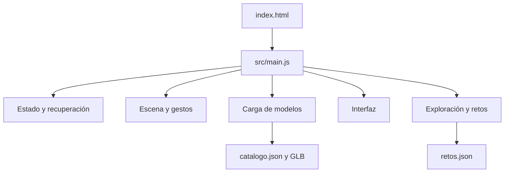

# Organización de ExplorAR

La aplicación usa módulos ES nativos y Three.js local. Sigue funcionando como un sitio estático: no necesita un framework, un compilador ni un servidor de aplicación.

## Responsabilidades

| Carpeta / archivo | Responsabilidad |
| --- | --- |
| `index.html` | Estructura, formularios y regiones accesibles. No contiene la lógica de la aplicación ni estilos embebidos. |
| `src/bootstrap.js` | Inicio con mensaje legible si la inicialización o WebGL no están disponibles. |
| `src/main.js` | Crea los servicios, conecta sus dependencias e inicia la aplicación. Exporta `app` y su promesa `ready`. |
| `src/core/` | Estado compartido explícito, operaciones matemáticas y deshacer la última eliminación. |
| `src/scene/engine.js` | Escena, luces, cámara y renderer. |
| `src/scene/selection.js` | Halo de selección y aros de giro. |
| `src/scene/interactions.js` | Selección por rayos, ratón, punteros y gestos táctiles. |
| `src/scene/collection.js` | Zoom y giro de la vista conjunta. |
| `src/scene/annotations.js` | Etiquetas y conectores rectos en WebGL, intersección con la superficie del modelo y profundidad compartida. |
| `src/ui/effects.js` | Perspectiva decorativa limitada al movimiento sobre el lienzo, sin modificar la cámara, y respeto de movimiento reducido. |
| `src/ui/thumbnails.js` | Miniaturas reales del componente en un render target; caché débil por objeto y color, sin duplicar geometría ni disponer materiales del modelo. |
| `src/ui/pagination.js` | Divide el contenido en páginas por filas completas y líneas de texto, mantiene el foco en contenido visible y revela los errores de formulario. |
| `src/ui/hud.js` | Coordina la navegación integrada, un único diálogo secundario abierto y el retorno de foco. |
| `src/scene/loop.js` | Actualiza cámara y escena; permite iniciar, parar o renderizar un fotograma. |
| `src/models/` | Validación del catálogo y GLB, carga, normalización, materiales y optimización de mallas compatibles. |
| `src/ui/` | Biblioteca, importación local, editor, paneles, ficha, cámara del dispositivo y posición de controles. |
| `src/education/` | Observación individual, ficha móvil, pasos del reto, pistas y evaluación de respuestas. |
| `styles/` | Estilos base, componentes, adaptación de pantallas y experiencia educativa. |
| `modelos-3d/catalogo.json` | Archivos, nombres, datos y presentación inicial de los modelos. |
| `contenido/retos.json` | Resúmenes educativos, objetivos, observaciones, preguntas, pistas y actividades de profundización. |
| `tests/` | Pruebas unitarias y pruebas de navegador con modelos GLB reales. |

## Composición y estado

Cada servicio recibe el contexto `app` y publica las operaciones que necesitan los demás. Los módulos se importan desde `main.js`; las llamadas entre servicios se resuelven después de componerlos, sin dependencias de importación circulares. `app.state` es la fuente de verdad para selección, vista, catálogo, gestos, componente aislado y panel abierto (`hudSurface`), además del despliegue independiente de la navegación (`navigationExpanded`). Los materiales y geometrías pertenecen a los objetos de la escena.

La eliminación conserva temporalmente un único objeto para poder deshacerla, incluso si procede de una importación local. Otra eliminación o una recarga del catálogo libera ese objeto y sus recursos. El historial no crece indefinidamente.

El bucle se detiene al abandonar u ocultar la página y se reanuda al volver. La cámara detiene sus pistas al volver a la vista 3D o salir de la página. Un contador de solicitudes invalida permisos que llegan después de cancelar; los fallos de reproducción y las pistas finalizadas limpian el vídeo y recuperan el estado 3D. Las pruebas pueden detener la animación y renderizar fotogramas concretos para verificar el estado sin saturar el renderizado por software.

## Visibilidad de controles

La selección solo activa una fila de cinco iconos, incluido el acceso directo a Ficha y reto. El editor completo se abre por petición explícita. `hud.js` mantiene Herramientas como una navegación lateral independiente, sin modalidad. En escritorio aparece de inicio; en móvil se pliega y se cierra al elegir una acción. Biblioteca, escena, ayuda, editor, ficha y controles conjuntos son diálogos secundarios: abrir uno cierra el anterior. Los diálogos modales contienen el foco hasta cerrarse. Ficha, Más datos y Reto comparten el comportamiento de diálogo no modal en escritorio amplio (1100 px de ancho y 650 px de alto como mínimo), permanecen a la derecha y dejan disponibles la escena y las acciones. Al pasar a móvil se convierten en modales; los eventos de cierre anteriores no cierran la presentación nueva. El encuadre utiliza siempre la pantalla completa, sin desplazarse ni cambiar de escala al abrir paneles o plegar la navegación; las posiciones de las acciones flotantes evitan esa barra. `styles/hud.css` organiza las superficies y sus adaptaciones móviles. Los contenedores extensos usan `pagination.js`: una ventana sin desplazamiento muestra una página completa y sus flechas permiten avanzar o volver. Los controles fuera de página quedan inertes y ocultos para tecnologías de asistencia. El texto extenso se divide entre líneas, y las filas de controles permanecen juntas. Las secciones desplegadas comienzan en página propia; los títulos acompañan al primer contenido y los controles numéricos comparten página con su slider. El pie identifica la sección actual. Las acciones finales de la ficha, el reintento y los ajustes se mantienen junto al bloque anterior mediante `data-keep-previous`, para evitar páginas con un botón aislado. La ficha educativa usa tipografía y espaciado compactos, conservando objetivos táctiles de 44 px. Se recalcula al cambiar el contenido o el tamaño de pantalla; los formularios muestran la página del campo inválido. `styles/pagination.css` define esta presentación. `styles/density.css` centraliza el espaciado compacto de toda la interfaz y la mayor altura disponible de los paneles informativos, manteniendo controles de al menos 44 px. `styles/cards.css` concentra la tipografía y composición final de fichas, retos y datos técnicos, separada de la identidad decorativa.

`styles/identity.css` usa contornos asimétricos y un segundo trazo suavemente irregular, sin deformar texto ni controles, y reproduce la composición de la referencia: aula y mesa como fondo decorativo, personaje con transparencia, logo grande, paleta amarillo/violeta/turquesa/rosa y bordes cian. En escritorio amplio las acciones se sitúan en una barra inferior con rótulos; en móvil permanecen compactas junto al componente. La ficha principal reúne descripción, datos principales y exploración individual en una sola vista para el catálogo. Reto y Más datos abren superficies independientes (`challenge` y `technical`); Escape y la flecha de regreso reabren la ficha y enfocan su activador. Solo estas superficies usan páginas cuando el contenido lo necesita. `assets/README.md` registra los recursos generados y sus prompts.

Los conectores son `THREE.Line` con dos extremos: la superficie del modelo obtenida por raycasting y el borde inferior de su etiqueta. Comparten la profundidad de la escena. Dos puntos circulares con borde oscuro marcan sus extremos; mantienen su tamaño en píxeles al cambiar el zoom y no capturan pulsaciones. Las etiquetas escriben profundidad solo en su silueta visible mediante `alphaTest`; sus esquinas transparentes no bloquean conectores. Una línea delante de otra etiqueta se mantiene visible; detrás se oculta por oclusión real. Se recalcula la intersección solo cuando cambia el modelo, la etiqueta o la orientación de cámara. Eliminar un componente libera la línea y sus recursos; deshacer la recrea.

## Editar contenido educativo

Añade o modifica una entrada de `contenido/retos.json`. `modelo` debe coincidir con un `id` del catálogo. `correcta` es el índice de la opción correcta, empezando en cero. Usa `resumen` para la descripción breve de la ficha. Incluye una explicación y una pista útiles para poder volver a intentar la pregunta. `profundiza` propone una actividad abierta; la aplicación no la califica automáticamente.

Los pasos **Observar** y **Responder** separan la exploración del cuestionario. **Ver solo este componente** oculta los otros modelos y centra la vista, conservando sus transformaciones. Al volver a todos, recupera la vista anterior. Las respuestas permanecen en memoria hasta guardarse manualmente con la escena; no se piden nombres ni edad.

Un modelo local o un componente sin reto mantiene una propuesta de observación libre. Si falta el archivo de retos, la escena sigue funcionando. Los modelos muestran geometría y materiales; no simulan mediciones ni el funcionamiento eléctrico de los sensores.

## Verificación

- `npm run check`: sintaxis, imports locales, rutas de modelos, preguntas e identificadores del HTML.
- `npm test`: contenido de los retos, evaluación, reintentos, precisión angular.
- `npm run test:browser`: escena con dos GLB ligeros reales, controles, importación, recuperación, retos y pantallas móviles.
- `npm run test:browser -- --all-models`: comprueba la colección inicial completa y el modelo Arduino UNO opcional.

- `npm run test:inspector`: recorre observación, cuestionario, feedback y datos técnicos; verifica que las acciones no ocupen una página sin contenido.
- `npm run test:effects`: profundidad decorativa, hover de gelatina, acción de botones y movimiento reducido; simula ratón fino para las media queries en Chrome sin interfaz.
- `npm run test:centering`: centro del viewport completo y encuadre estable ante paneles y navegación, con tipografía Comic Sans.
- `npm run test:panels`: comportamiento común de ficha, datos y reto, transición escritorio/móvil, acciones de la escena, altura y espaciado.
- `npm run test:reference`: miniaturas, ficha integrada, interacción con ella abierta, transición a modal móvil y capturas a tamaño de referencia.
- `npm run test:pagination`: recorre las páginas con flechas, comprueba controles completos, ausencia de desplazamiento vertical, listas largas y campos requeridos.
- `npm run test:accessibility`: auditoría axe en distintos estados y pantallas, tamaños de controles y movimiento reducido. Véase [accesibilidad](accesibilidad.md) para alcance y evaluación pendiente.

Las pruebas de navegador requieren Chrome/Chromium. Se puede indicar su ruta con `BROWSER_PATH`. Las capturas se guardan en la carpeta temporal `explorar-qa` del sistema.

## Entrega reproducible

`scripts/verify-release.mjs` ejecuta las comprobaciones en serie y registra versiones, logs, capturas y huella de fuentes antes/después. `release-files.mjs` define una lista explícita de archivos para distribución. `prepare-release.mjs` exige un informe aprobado de la misma huella, copia el sitio, verifica cada archivo y ejecuta una prueba HTTP sobre la copia. El paquete se marca como candidato con pendientes humanos y de procedencia. Véanse [publicación](publicacion.md) y [cierre](cierre-v1.md).

Los efectos visuales están en `styles/effects.css`: el contorno del panel recibe la perspectiva para mantener estables el texto y las medidas de paginación. Los botones acompañan esa inclinación; el hover ejecuta una oscilación breve y única en dispositivos con ratón. `prefers-reduced-motion` desactiva estos movimientos. No se transforma el canvas ni se cambia el encuadre.

## Escenas y laboratorio (1.1)

- `storage/project-format.js` valida y normaliza un documento versionado; incluye GLB locales en base64, transformaciones, selección, aislamiento, respuestas, partes visitadas y actividad. Rechaza rangos, referencias y tamaños no admitidos.
- `storage/project-store.js` encapsula IndexedDB; `ui/projects.js` coordina guardado, copias, exportación, importación, borrado/deshacer y apertura en dos fases. Primero prepara modelos fuera de la escena; solo después sustituye los objetos. Errores y cancelaciones liberan los recursos preparados. No hay guardado automático ni sincronización.
- `education/parts.js` enlaza `contenido/partes.json` con las cajas de nodos del GLB, conservadas antes de agrupar geometrías. Proyecta los puntos con la cámara de pantalla completa y comprueba oclusión. Ofrece una lista equivalente y registra las partes visitadas. Los seis sensores tienen contenido; los modelos locales y Arduino conservan exploración libre.
- `education/ldr-model.js` contiene una relación cualitativa monótona sin unidades. `education/experiment.js` controla luz virtual, arrastre/teclado, observaciones y explicación por objeto. No calcula un circuito ni toma datos de cámara. Partes y luz son modos explícitos excluyentes y se cierran al cambiar de objeto.
- `styles/laboratory.css` presenta las herramientas opcionales dentro del sistema visual existente. Los nuevos módulos se inicializan antes de montar la paginación y el HUD.

## Misiones guiadas (1.2)

`education/mission-model.js` valida los recorridos y evalúa evidencia de acciones: visitas a partes distintas, observaciones contrastadas, respuesta correcta y presencia de escritura. No evalúa calidad de explicaciones. `education/missions.js` coordina el paso actual, enlaces a herramientas, retorno desde los paneles, progreso derivado y exportación de evidencias. Las definiciones residen en `contenido/misiones.json`.

El documento de escena incorpora `journey` opcional (id, paso y notas). Los archivos anteriores conservan compatibilidad: omitirlo carga exploración libre. El progreso se vuelve a calcular desde partes, observaciones y respuestas restauradas. El listado IndexedDB conserva solo resúmenes en memoria; el documento completo se solicita al abrir o eliminar una escena. La preparación inicial termina antes de permitir guardados o restauraciones.

`test:missions` recorre las dos misiones completas, exporta evidencias, restaura el avance y comprueba paginación y axe en cuatro tamaños. `verify:release` incluye estas pruebas y las de proyectos/laboratorio.

## Laboratorios independientes (1.3)

`education/experiments.js` elige el laboratorio para el componente seleccionado y conserva la API usada por la interfaz. LDR y eco mantienen módulos y datos separados. Cambiar a un componente incompatible cierra el laboratorio anterior; limpiar la selección cierra los paneles de datos del objeto. La apertura sigue siendo explícita.

`echo-model.js` contiene el cálculo ideal y la representación textual de ausencia de eco; `echo-experiment.js` coordina datos, controles y el esquema WebGL. El obstáculo y los recorridos están fuera de los objetos guardables, siguen la matriz del sensor y se ocultan al terminar. El arrastre por raycasting sobre el bloque y el control HTML comparten la proyección del recorrido; capturan el puntero y no transforman el sensor. Los buffers del dibujo se actualizan sin crear geometrías en cada fotograma; los extremos usan puntos circulares de tamaño fijo. El dibujo se actualiza antes de renderizar.

`echoActivity` es opcional dentro de cada entrada del archivo de escena. Conserva distancia simulada, presencia del obstáculo, hasta 12 observaciones y explicación. El validador exige tipos y rangos y los archivos anteriores siguen siendo válidos. Las evidencias exportan las observaciones aunque la explicación todavía esté vacía. El criterio `echo-observations` exige cerca, lejos y ausencia de eco; la escritura sigue requiriendo revisión docente.

`test:echo` comprueba arrastre real del cuerpo 3D y del control, teclado, ausencia de eco, recorrido educativo, exportación, restauración y páginas accesibles en cuatro tamaños. El script de entrega incluye estas pruebas.

## AR de superficies (1.4)

`scene/spatial-ar.js` controla una sesión WebXR `immersive-ar` con `local` y `hit-test` obligatorios y `dom-overlay` opcional. `surface-pose.js` filtra poses finitas cuya normal está próxima a vertical positiva; no acepta paredes ni techos. La fuente de hit test se crea desde el espacio viewer y sus poses se leen en el espacio local del renderer.

El modo usa una escena separada con clones de las mallas, materiales y geometrías compartidos, sin modificar los originales. El conjunto se centra sobre su base y se normaliza a una dimensión mayor de 0,5 metros; el giro y tamaño AR son temporales. La guía es el único recurso gráfico propio que se dispone al cerrar; los recursos compartidos nunca se liberan desde AR. No se crean mapas de malla, polígonos de planos, oclusión del entorno, anclajes persistentes ni poses guardadas.

La sesión pausa el bucle normal y utiliza `renderer.setAnimationLoop` con el XRFrame real. No usa postprocesado de halo ni cambia la cámara del laboratorio. Un fotograma sin pose de vista o sesión oculta invalida la guía y oculta el contenido colocado; el evento reset del espacio local vuelve a búsqueda. El toque solo coloca con un hit reciente. Los eventos de la superposición previenen selección XR accidental.

Los permisos se piden únicamente desde la acción del usuario. Cancelar invalida la solicitud; un permiso tardío cierra la sesión recibida. Salida nativa, errores de fuente y pagehide limpian fuente, bucle XR, guía y superposición, restauran interacción y reanudan el bucle cuando corresponde. El modo cámara se detiene antes de solicitar AR. `test:surfaces` simula la sesión y el puente XR del renderer: no valida el compositor nativo ni sensores físicos.
