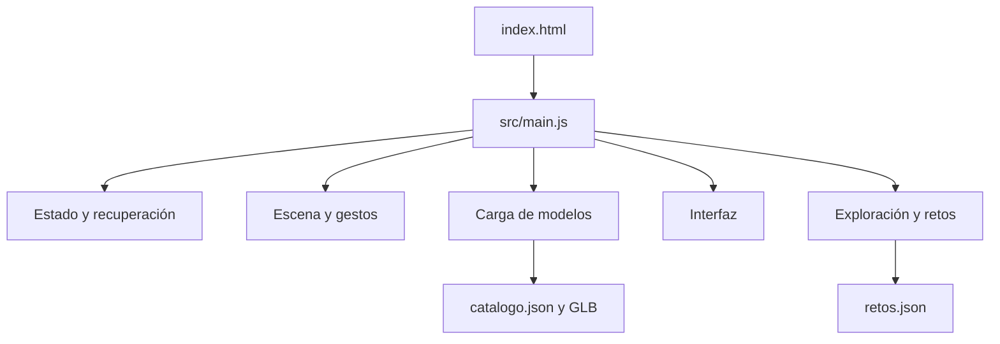

# Organización de ExplorAR

La aplicación usa módulos ES nativos y Three.js local. Sigue funcionando como un sitio estático: no necesita un framework, un compilador ni un servidor de aplicación.

## Responsabilidades

| Carpeta / archivo | Responsabilidad |
| --- | --- |
| `index.html` | Estructura, formularios y regiones accesibles. No contiene la lógica de la aplicación ni estilos embebidos. |
| `src/bootstrap.js` | Inicio con mensaje legible si la inicialización o WebGL no están disponibles. |
| `src/main.js` | Crea los servicios, conecta sus dependencias e inicia la aplicación. Exporta `app` y su promesa `ready`. |
| `src/core/` | Estado compartido explícito, operaciones matemáticas y deshacer la última eliminación. |
| `src/scene/engine.js` | Escena, luces, cámara y renderer. |
| `src/scene/selection.js` | Halo de selección y aros de giro. |
| `src/scene/interactions.js` | Selección por rayos, ratón, punteros y gestos táctiles. |
| `src/scene/collection.js` | Zoom y giro de la vista conjunta. |
| `src/scene/annotations.js` | Etiquetas y conectores rectos en WebGL, intersección con la superficie del modelo y profundidad compartida. |
| `src/ui/effects.js` | Perspectiva decorativa limitada al movimiento sobre el lienzo, sin modificar la cámara, y respeto de movimiento reducido. |
| `src/ui/thumbnails.js` | Miniaturas reales del componente en un render target; caché débil por objeto y color, sin duplicar geometría ni disponer materiales del modelo. |
| `src/ui/pagination.js` | Divide el contenido en páginas por filas completas y líneas de texto, mantiene el foco en contenido visible y revela los errores de formulario. |
| `src/ui/hud.js` | Coordina la navegación integrada, un único diálogo secundario abierto y el retorno de foco. |
| `src/scene/loop.js` | Actualiza cámara y escena; permite iniciar, parar o renderizar un fotograma. |
| `src/models/` | Validación del catálogo y carga de GLB, glTF, OBJ/MTL, FBX, STL y PLY; integración local de recursos en GLB, normalización, materiales y optimización de mallas compatibles. |
| `src/ui/` | Biblioteca, importación local, editor, paneles, ficha, cámara del dispositivo y posición de controles. |
| `src/education/` | Observación individual, ficha móvil, pasos del reto, pistas y evaluación de respuestas. |
| `styles/` | Estilos base, componentes, adaptación de pantallas y experiencia educativa. |
| `modelos-3d/catalogo.json` | Archivos, nombres, datos y presentación inicial de los modelos. |
| `contenido/retos.json` | Resúmenes educativos, objetivos, observaciones, preguntas, pistas y actividades de profundización. |
| `tests/` | Pruebas unitarias y pruebas de navegador con modelos GLB reales. |

## Composición y estado

Cada servicio recibe el contexto `app` y publica las operaciones que necesitan los demás. Los módulos se importan desde `main.js`; las llamadas entre servicios se resuelven después de componerlos, sin dependencias de importación circulares. `app.state` es la fuente de verdad para selección, vista, catálogo, gestos, componente aislado y panel abierto (`hudSurface`), además del despliegue independiente de la navegación (`navigationExpanded`). Los materiales y geometrías pertenecen a los objetos de la escena.

La eliminación conserva temporalmente un único objeto para poder deshacerla, incluso si procede de una importación local. Otra eliminación o una recarga del catálogo libera ese objeto y sus recursos. El historial no crece indefinidamente.

El bucle se detiene al abandonar u ocultar la página y se reanuda al volver. La cámara detiene sus pistas al volver a la vista 3D o salir de la página. Un contador de solicitudes invalida permisos que llegan después de cancelar; los fallos de reproducción y las pistas finalizadas limpian el vídeo y recuperan el estado 3D. Las pruebas pueden detener la animación y renderizar fotogramas concretos para verificar el estado sin saturar el renderizado por software.

## Visibilidad de controles

La selección solo activa una fila de cinco iconos, incluido el acceso directo a Ficha y reto. El editor completo se abre por petición explícita. `hud.js` mantiene Herramientas como una navegación lateral independiente, sin modalidad. En escritorio aparece de inicio; en móvil se pliega y se cierra al elegir una acción. Biblioteca, escena, ayuda, editor, ficha y controles conjuntos son diálogos secundarios: abrir uno cierra el anterior. Los diálogos modales contienen el foco hasta cerrarse. Ficha, Más datos y Reto comparten el comportamiento de diálogo no modal en escritorio amplio (1100 px de ancho y 650 px de alto como mínimo), permanecen a la derecha y dejan disponibles la escena y las acciones. Al pasar a móvil se convierten en modales; los eventos de cierre anteriores no cierran la presentación nueva. El encuadre utiliza siempre la pantalla completa, sin desplazarse ni cambiar de escala al abrir paneles o plegar la navegación; las posiciones de las acciones flotantes evitan esa barra. `styles/hud.css` organiza las superficies y sus adaptaciones móviles. Los contenedores extensos usan `pagination.js`: una ventana sin desplazamiento muestra una página completa y sus flechas permiten avanzar o volver. Los controles fuera de página quedan inertes y ocultos para tecnologías de asistencia. El texto extenso se divide entre líneas, y las filas de controles permanecen juntas. Las secciones desplegadas comienzan en página propia; los títulos acompañan al primer contenido y los controles numéricos comparten página con su slider. El pie identifica la sección actual. Las acciones finales de la ficha, el reintento y los ajustes se mantienen junto al bloque anterior mediante `data-keep-previous`, para evitar páginas con un botón aislado. La ficha educativa usa tipografía y espaciado compactos, conservando objetivos táctiles de 44 px. Se recalcula al cambiar el contenido o el tamaño de pantalla; los formularios muestran la página del campo inválido. `styles/pagination.css` define esta presentación. `styles/density.css` centraliza el espaciado compacto de toda la interfaz y la mayor altura disponible de los paneles informativos, manteniendo controles de al menos 44 px. `styles/cards.css` concentra la tipografía y composición final de fichas, retos y datos técnicos, separada de la identidad decorativa.

`styles/identity.css` usa contornos asimétricos y un segundo trazo suavemente irregular, sin deformar texto ni controles, y reproduce la composición de la referencia: aula y mesa como fondo decorativo, personaje con transparencia, logo grande, paleta amarillo/violeta/turquesa/rosa y bordes cian. En escritorio amplio las acciones se sitúan en una barra inferior con rótulos; en móvil permanecen compactas junto al componente. La ficha principal reúne descripción, datos principales y exploración individual en una sola vista para el catálogo. Reto y Más datos abren superficies independientes (`challenge` y `technical`); Escape y la flecha de regreso reabren la ficha y enfocan su activador. Solo estas superficies usan páginas cuando el contenido lo necesita. `assets/README.md` registra los recursos generados y sus prompts.

Los conectores son `THREE.Line` con dos extremos: la superficie del modelo obtenida por raycasting y el borde de la etiqueta más cercano al modelo. Conservan profundidad 3D frente a los objetos. Dos puntos circulares mantienen su tamaño en píxeles y no capturan pulsaciones. Los nombres se dibujan en primer plano con `depthTest: false`, `depthWrite: false` y `renderOrder: 1000`: la geometría no los atraviesa. `src/scene/name-label-layout.js` mantiene su tamaño en pantalla y busca posiciones fuera de la proyección de las piezas, dentro del visor y sin interferir con controles u otros nombres. Si no existe una posición segura cercana, oculta el nombre y su conector. La altura configurada sigue siendo una preferencia de ubicación. Eliminar un componente libera el conector y sus recursos; deshacer lo recrea.

## Editar contenido educativo

Añade o modifica una entrada de `contenido/retos.json`. `modelo` debe coincidir con un `id` del catálogo. `correcta` es el índice de la opción correcta, empezando en cero. Usa `resumen` para la descripción breve de la ficha. Incluye una explicación y una pista útiles para poder volver a intentar la pregunta. `profundiza` propone una actividad abierta; la aplicación no la califica automáticamente.

Los pasos **Observar** y **Responder** separan la exploración del cuestionario. **Ver solo este componente** oculta los otros modelos y centra la vista, conservando sus transformaciones. Al volver a todos, recupera la vista anterior. Las respuestas permanecen en memoria hasta guardarse manualmente con la escena; no se piden nombres ni edad.

Un modelo local o un componente sin reto mantiene una propuesta de observación libre. Si falta el archivo de retos, la escena sigue funcionando. Los modelos muestran geometría y materiales; no simulan mediciones ni el funcionamiento eléctrico de los sensores.

## Verificación

- `npm run check`: sintaxis, imports locales, rutas de modelos, preguntas e identificadores del HTML.
- `npm test`: contenido de los retos, evaluación, reintentos, precisión angular.
- `npm run test:browser`: escena con dos GLB ligeros reales, controles, importación, recuperación, retos y pantallas móviles.
- `npm run test:browser -- --all-models`: comprueba la colección inicial completa y el modelo Arduino UNO opcional.

- `npm run test:inspector`: recorre observación, cuestionario, feedback y datos técnicos; verifica que las acciones no ocupen una página sin contenido.
- `npm run test:effects`: profundidad decorativa, hover de gelatina, acción de botones y movimiento reducido; simula ratón fino para las media queries en Chrome sin interfaz.
- `npm run test:centering`: centro del viewport completo y encuadre estable ante paneles y navegación, con tipografía Comic Sans.
- `npm run test:panels`: comportamiento común de ficha, datos y reto, transición escritorio/móvil, acciones de la escena, altura y espaciado.
- `npm run test:reference`: miniaturas, ficha integrada, interacción con ella abierta, transición a modal móvil y capturas a tamaño de referencia.
- `npm run test:pagination`: recorre las páginas con flechas, comprueba controles completos, ausencia de desplazamiento vertical, listas largas y campos requeridos.
- `npm run test:accessibility`: auditoría axe en distintos estados y pantallas, tamaños de controles y movimiento reducido. Véase [accesibilidad](accesibilidad.md) para alcance y evaluación pendiente.

Las pruebas de navegador requieren Chrome/Chromium. Se puede indicar su ruta con `BROWSER_PATH`. Las capturas se guardan en la carpeta temporal `explorar-qa` del sistema.

## Entrega reproducible

`scripts/verify-release.mjs` ejecuta las comprobaciones en serie y registra versiones, logs, capturas y huella de fuentes antes/después. `release-files.mjs` define una lista explícita de archivos para distribución. `prepare-release.mjs` exige un informe aprobado de la misma huella, copia el sitio, verifica cada archivo y ejecuta una prueba HTTP sobre la copia. El paquete se marca como candidato con pendientes humanos y de procedencia. Véanse [publicación](publicacion.md) y [cierre](cierre-v1.md).

Los efectos visuales están en `styles/effects.css`: el contorno del panel recibe la perspectiva para mantener estables el texto y las medidas de paginación. Los botones acompañan esa inclinación; el hover ejecuta una oscilación breve y única en dispositivos con ratón. `prefers-reduced-motion` desactiva estos movimientos. No se transforma el canvas ni se cambia el encuadre.

## Escenas y laboratorio (1.1)

- `storage/project-format.js` valida y normaliza un documento versionado; incluye GLB locales en base64, transformaciones, selección, aislamiento, respuestas, partes visitadas y actividad. Rechaza rangos, referencias y tamaños no admitidos.
- `storage/project-store.js` encapsula IndexedDB; `ui/projects.js` coordina guardado, copias, exportación, importación, borrado/deshacer y apertura en dos fases. Primero prepara modelos fuera de la escena; solo después sustituye los objetos. Errores y cancelaciones liberan los recursos preparados. No hay guardado automático ni sincronización.
- `education/parts.js` enlaza `contenido/partes.json` con las cajas de nodos del GLB, conservadas antes de agrupar geometrías. Proyecta los puntos con la cámara de pantalla completa y comprueba oclusión. Ofrece una lista equivalente y registra las partes visitadas. Los seis sensores tienen contenido; los modelos locales y Arduino conservan exploración libre.
- `education/ldr-model.js` contiene una relación cualitativa monótona sin unidades. `education/experiment.js` controla luz virtual, arrastre/teclado, observaciones y explicación por objeto. No calcula un circuito ni toma datos de cámara. Partes y luz son modos explícitos excluyentes y se cierran al cambiar de objeto.
- `styles/laboratory.css` presenta las herramientas opcionales dentro del sistema visual existente. Los nuevos módulos se inicializan antes de montar la paginación y el HUD.

## Misiones guiadas (1.2)

`education/mission-model.js` valida los recorridos y evalúa evidencia de acciones: visitas a partes distintas, observaciones contrastadas, respuesta correcta y presencia de escritura. No evalúa calidad de explicaciones. `education/missions.js` coordina el paso actual, enlaces a herramientas, retorno desde los paneles, progreso derivado y exportación de evidencias. Las definiciones residen en `contenido/misiones.json`.

El documento de escena incorpora `journey` opcional (id, paso y notas). Los archivos anteriores conservan compatibilidad: omitirlo carga exploración libre. El progreso se vuelve a calcular desde partes, observaciones y respuestas restauradas. El listado IndexedDB conserva solo resúmenes en memoria; el documento completo se solicita al abrir o eliminar una escena. La preparación inicial termina antes de permitir guardados o restauraciones.

`test:missions` recorre las dos misiones completas, exporta evidencias, restaura el avance y comprueba paginación y axe en cuatro tamaños. `verify:release` incluye estas pruebas y las de proyectos/laboratorio.

## Laboratorios independientes (1.3)

`education/experiments.js` elige el laboratorio para el componente seleccionado y conserva la API usada por la interfaz. LDR y eco mantienen módulos y datos separados. Cambiar a un componente incompatible cierra el laboratorio anterior; limpiar la selección cierra los paneles de datos del objeto. La apertura sigue siendo explícita.

`echo-model.js` contiene el cálculo ideal y la representación textual de ausencia de eco; `echo-experiment.js` coordina datos, controles y el esquema WebGL. El obstáculo y los recorridos están fuera de los objetos guardables, siguen la matriz del sensor y se ocultan al terminar. El arrastre por raycasting sobre el bloque y el control HTML comparten la proyección del recorrido; capturan el puntero y no transforman el sensor. Los buffers del dibujo se actualizan sin crear geometrías en cada fotograma; los extremos usan puntos circulares de tamaño fijo. El dibujo se actualiza antes de renderizar.

`echoActivity` es opcional dentro de cada entrada del archivo de escena. Conserva distancia simulada, presencia del obstáculo, hasta 12 observaciones y explicación. El validador exige tipos y rangos y los archivos anteriores siguen siendo válidos. Las evidencias exportan las observaciones aunque la explicación todavía esté vacía. El criterio `echo-observations` exige cerca, lejos y ausencia de eco; la escritura sigue requiriendo revisión docente.

`test:echo` comprueba arrastre real del cuerpo 3D y del control, teclado, ausencia de eco, recorrido educativo, exportación, restauración y páginas accesibles en cuatro tamaños. El script de entrega incluye estas pruebas.

## AR de superficies (1.4)

`scene/spatial-ar.js` controla una sesión WebXR `immersive-ar` con `local` y `hit-test` obligatorios y `dom-overlay` / `anchors` opcionales. `surface-pose.js` filtra poses finitas cuya normal está próxima a vertical positiva; no acepta paredes ni techos. La fuente de hit test se crea desde el espacio viewer y sus poses se leen en el espacio local del renderer.

El modo usa una escena separada con clones de las mallas, materiales y geometrías compartidos, sin modificar los originales. El conjunto se centra sobre su base y se normaliza a una dimensión mayor de 0,5 metros; el giro y tamaño AR son temporales. La guía y los conectores creados para las etiquetas se liberan al cerrar; los recursos compartidos nunca se liberan desde AR. Se visualizan polígonos nativos de planos cuando el dispositivo los proporciona; no se reconstruyen mapas volumétricos, oclusión del entorno, anclajes persistentes ni poses guardadas.

La sesión pausa el bucle normal y utiliza `renderer.setAnimationLoop` con el XRFrame real. No usa postprocesado de halo ni cambia la cámara del laboratorio. Una pose de vista ausente, emulada o sin sesión visible invalida la guía y oculta el contenido colocado. La guía suaviza posición y orientación con un filtro dependiente del tiempo; exige tres lecturas durante al menos 150 ms dentro de 3,5 cm de la primera medición y con normales próximas. Conserva el aro ámbar durante huecos de hasta 250 ms, sin permitir colocar sin un hit actual. No extrapola planos. La confirmación se consume en el siguiente XRFrame, se comprueba de nuevo la estabilidad y se usa la medición actual tanto para colocar como para crear el ancla. Los eventos de la superposición previenen selección XR accidental. Si está disponible, `XRHitTestResult.createAnchor()` crea un ancla de sesión y cada fotograma consulta `anchorSpace`; cuando falta seguimiento del ancla se oculta el modelo hasta recuperarlo. `anchor-tracking.js` valida transformaciones rígidas finitas y exige, al adquirir o recuperar el ancla y después de un reset, al menos cuatro muestras durante 200 ms dentro de 2 cm y 3° de una referencia inicial. Es un criterio de coherencia temporal, no una medida ni una garantía de precisión física. Una pérdida, pose inválida o intervalo entre fotogramas superior a 250 ms reinicia esta comprobación. Una vez recuperada, la pose nativa se aplica directamente: filtrar sus correcciones sin filtrar las de cámara introduciría deslizamiento aparente. La orientación de la cámara no modifica la transformación del modelo y nunca se crea otra ancla automáticamente al perder seguimiento. Sin anclas, se avisa de la posible deriva. Un reset conserva el ancla; sin ella, se compensa con la inversa de `event.transform`, o se exige recolocar si no hay transformación. Otro lugar y la salida eliminan el ancla; las creaciones asíncronas tardías también se eliminan.

Los permisos se piden únicamente desde la acción del usuario. Cancelar invalida la solicitud; un permiso tardío cierra la sesión recibida. Salida nativa, errores de fuente y pagehide limpian fuente, bucle XR, guía y superposición, restauran interacción y reanudan el bucle cuando corresponde. El modo cámara se detiene antes de solicitar AR. `test:surfaces` simula la sesión y el puente XR del renderer: no valida el compositor nativo ni sensores físicos.

### Presentación AR y mecanismos

`ar-content.js` clona mallas y etiquetas y vincula los pivotes clonados a un estado mecánico independiente. `education/gear-motion.js` comparte con el laboratorio el cálculo de relaciones de giro, separación, aislamiento e integración por fuerza; durante AR no se avanza el mecanismo original. La simulación AR solo avanza mientras el modelo tiene seguimiento visible.

Las etiquetas de nombre y sus conectores reutilizan `annotations.js` y `name-label-layout.js`. Las tarjetas de RPM/dientes/sentido reutilizan `gear-telemetry.js` en una capa propia dentro del overlay, con sus propios límites y obstáculos para evitar controles. Se actualiza la cámara desde WebXR antes de proyectar etiquetas. Las tarjetas corresponden al componente seleccionado, o al primer mecanismo del conjunto cuando no hay selección aplicable. Las etiquetas se ocultan junto con el modelo al perder seguimiento.

`ar-gestures.js` recibe eventos de puntero en la superficie AR: un dedo gira en X/Y, dos dedos añaden giro alrededor de Z y las flechas de teclado ofrecen un respaldo. La interacción modifica únicamente la rotación del contenido, conservando posición y escala del ancla. Los controles se limitan a colocación/recolocación, marcha/pausa cuando hay mecanismos y salida. Los gestos DOM y tarjetas usan la superposición DOM; existe respaldo por eventos táctiles y por rayos de entrada de pantalla WebXR cuando el runtime los proporciona; el nombre como sprite se mantiene en la escena 3D. El toque nativo sigue permitiendo colocar sin overlay. Se cancelan gestos al perder seguimiento, recolocar o salir; cada sesión libera sus conectores y tarjetas sin liberar materiales ni geometrías compartidos.

La entrada AR se captura en la raíz del overlay y excluye los controles. No depende de que el destino sea el div transparente ni de que funcione la captura nativa de punteros: si esta falla se sigue recibiendo el arrastre en la raíz. Los eventos táctiles ofrecen respaldo sin aplicar dos veces los Pointer Events. La entrada XR de pantalla se procesa solo cuando no hay un gesto DOM reciente; nunca modifica la pose del ancla.

La proyección de etiquetas usa el rectángulo de la superposición AR y los coeficientes de la matriz de proyección, independientemente del tamaño del canvas del laboratorio y de las diferencias de aspecto de la cámara XR. El nombre usa hasta 280 px en móvil y 320 px en pantallas amplias. Los límites de las tarjetas sprite se calculan como billboards frente a la cámara, incluso tras girar sus padres. Los conectores de ruedas tienen un trazo explícito de 1,4 px con contraste sobre la cámara. La prueba AR verifica tamaños proyectados y píxeles pintados de los conectores, además de existencia de nodos.

### Rastro de escaneo y sombra AR

`ar-scan-trail.js` muestra parches triangulares de 24 cm alrededor de los hits horizontales actuales, separados por altura y normal. El rastro conserva como máximo 48 muestras y desvanece cada parche durante siete segundos; una geometría de líneas y un material con tiempo uniforme mantienen un solo dibujo para toda la malla. Los parches visualizan las muestras del hit test, sin representar límites medidos ni reconstruir zonas que la cámara no ha observado. No se usa el rastro para autorizar colocación.

Al colocar se oculta la malla; Otro lugar y los cambios de origen limpian las muestras. La pérdida de seguimiento también las borra para evitar conservar coordenadas inciertas. Salir libera geometría y material del rastro.

`ar-shadow.js` coloca un receptor `ShadowMaterial` transparente de 2 × 2 metros a 1 mm sobre el plano local del ancla. El receptor y una luz direccional de sesión son hermanos del contenido giratorio: siguen el ancla, pero no los gestos de rotación del objeto. Solo las copias AR emiten sombra, con mapa de 512 × 512 y filtrado PCF suave; los originales conservan sus propiedades. El mapa se actualiza durante la animación y se libera al salir. La configuración previa de sombras del renderer se restaura incluso si se cancela la entrada. La sombra usa iluminación virtual y un receptor plano estimado; no mide luces reales ni contornos de la superficie física.

El acceso principal del pie es `#quick-ar` (Entrar en AR), que sustituye al botón de cámara de fondo. La compatibilidad se consulta al terminar la carga, sin solicitar permisos. Con compatibilidad confirmada, el clic solicita la sesión dentro del evento del usuario y coloca el componente seleccionado, o el conjunto visible si no hay selección. Si falta compatibilidad confirmada, abre el diálogo de superficies con la explicación y el reintento. La salida devuelve el foco a este acceso cuando corresponde. El controlador de cámara de fondo conserva su cierre y API internos, sin ocupar el botón principal.

### Aislamiento de arranque y mapa básico opcional

`spatial-entry.js` se inicializa con el laboratorio sin importar el motor AR. Solo carga `spatial-ar.js` de forma dinámica tras confirmar soporte de sesiones; un módulo AR que no descarga o un rechazo de la consulta no interrumpen el arranque 3D. El botón de una copia HTML anterior (`quick-camera`) se reconoce como acceso AR y el controlador valida los elementos opcionales antes de registrarse. `engine.js` intenta crear el renderer con antialiasing y vuelve a intentarlo en un canvas nuevo sin multisampling si falla. El bootstrap diferencia un fallo real de creación de gráficos de un fallo de módulos o inicialización y también recoge errores de `app.ready`.

El nombre en AR se dibuja con `ar-name-cards.js` en la misma superposición DOM que las tarjetas de cada rueda, con tamaño de fuente de al menos 16 px, límites de pantalla y ocultación durante pérdidas. Comparte el cálculo de ubicación/proyección y la reserva de espacio con las otras etiquetas; sin overlay conserva el sprite 3D. En modo DOM no se duplica su conector como línea WebGL.

La sesión pide `plane-detection` como función opcional. `ar-plane-map.js` dibuja una subdivisión de los polígonos nativos recibidos en `XRFrame.detectedPlanes`, con un máximo de 24 planos y 256 vértices por polígono. Consulta cada pose con `planeSpace`, actualiza geometría cuando cambia `lastChangedTime` y elimina planos que desaparecen. Así puede verse la malla durante el escaneo antes del primer hit y antes del aro. Si no hay datos nativos, se conserva el rastro de hits y la sesión funciona sin mapas. El mapa se oculta al colocar y se limpia en pérdida de seguimiento, cambio de origen y salida. No se usa para autorizar colocación ni se afirma que mejore la precisión del seguimiento nativo.
